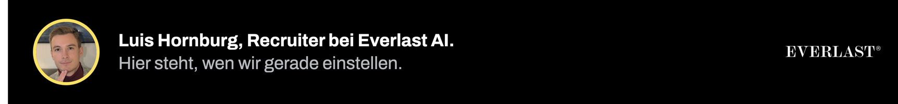
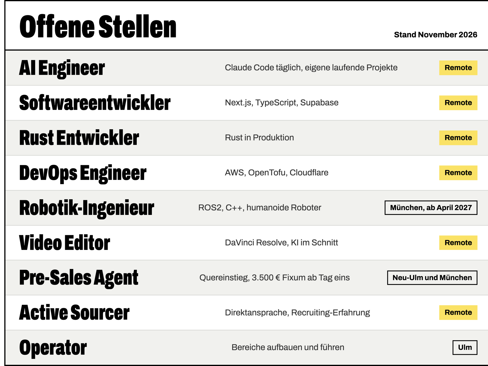
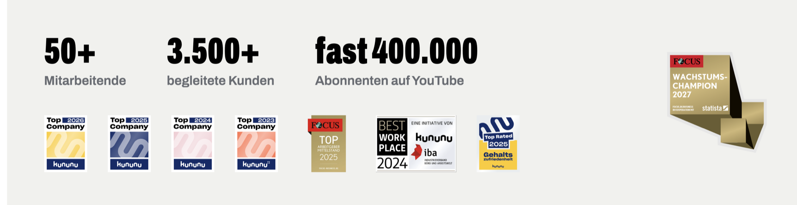
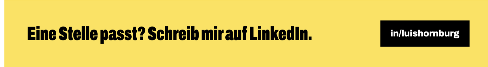

Wenn ich dir geschrieben habe, habe ich mir vorher deine Arbeit angesehen. Mein Sourcing-System baue ich selbst mit Claude Code, die wiederverwendbaren Teile sind unten angepinnt.

[Alle Stellen ansehen](https://everlast-media-gmbh.jobs.personio.de) oder [mir auf LinkedIn schreiben](https://www.linkedin.com/in/luishornburg).
